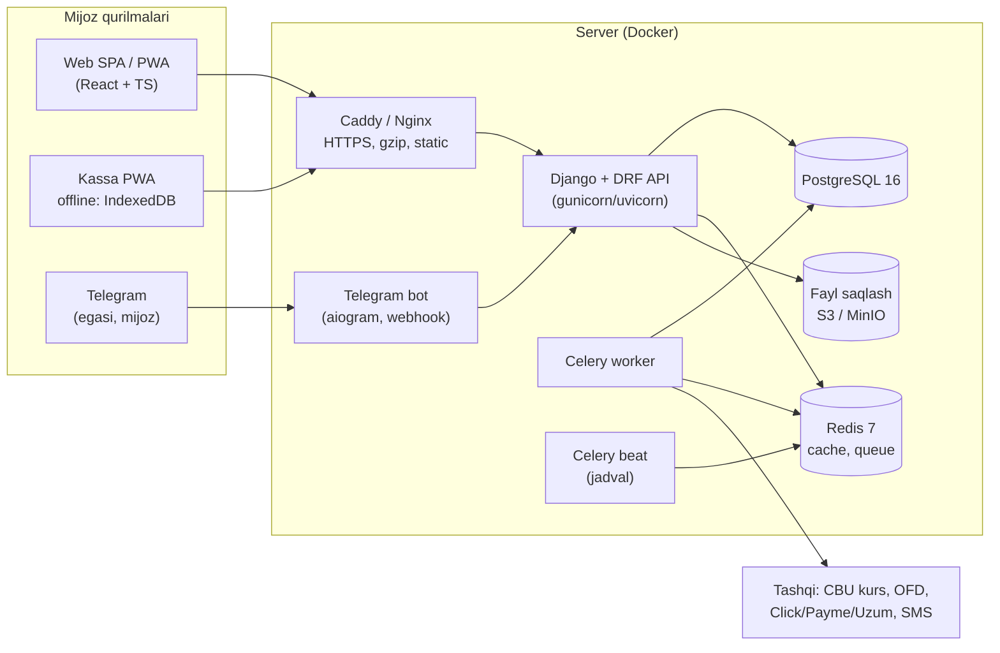
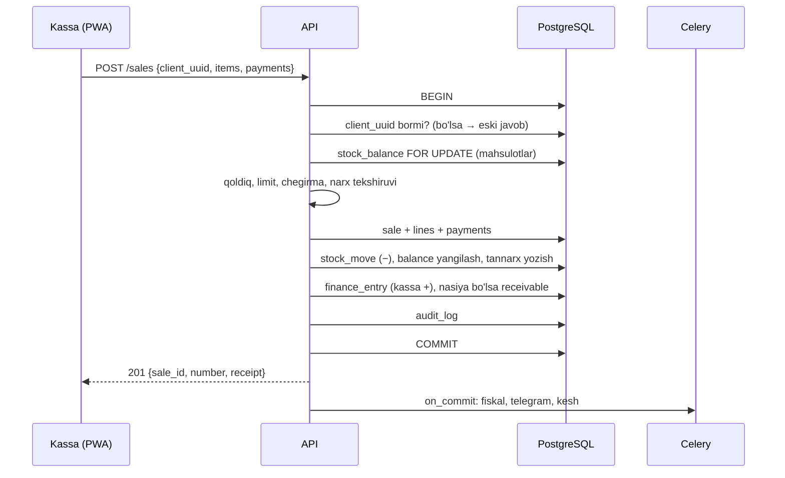
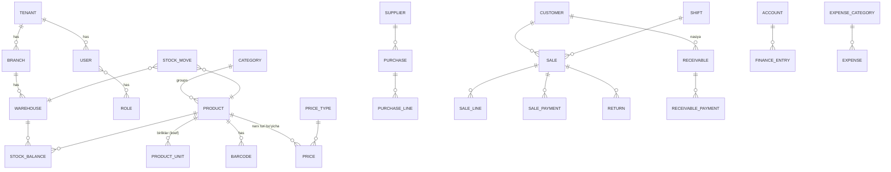

# Texnik topshiriq (TZ): "Qurilish Mollari CRM / POS" — 2.0

| | |
|---|---|
| **Hujjat versiyasi** | 1.0 (qoralama, ko'rib chiqish uchun) |
| **Sana** | 2026-11-20 |
| **Holat** | Muhokama → tasdiqlash → ishlab chiqish |
| **Maqsad** | Mavjud Django CRM'ni 0 dan, professional darajada qayta qurish va serverga joylash |

> Bu hujjat "nima qilamiz" va "qanday qilamiz"ni bitta joyda jamlaydi. Har bir funksiya ustuvorlik bilan belgilangan:
> **[MVP]** — birinchi relizda albatta bo'ladi, **[v2]** — keyingi bosqich, **[v3]** — kelajak rejasi.

---

## Mundarija

1. [Loyiha haqida](#1-loyiha-haqida)
2. [Bozor tahlili: raqobatchilardan nimani olamiz](#2-bozor-tahlili)
3. [Foydalanuvchilar va rollar](#3-foydalanuvchilar-va-rollar)
4. [Funksional talablar (modullar)](#4-funksional-talablar)
5. [Nofunksional talablar](#5-nofunksional-talablar)
6. [Arxitektura](#6-arxitektura)
7. [Texnologiyalar steki](#7-texnologiyalar-steki)
8. [Ma'lumotlar modeli](#8-malumotlar-modeli)
9. [API dizayni](#9-api-dizayni)
10. [UI/UX va dizayn tizimi](#10-uiux-va-dizayn-tizimi)
11. [Xavfsizlik](#11-xavfsizlik)
12. [DevOps, server va monitoring](#12-devops-server-va-monitoring)
13. [Test strategiyasi](#13-test-strategiyasi)
14. [Eski tizimdan ma'lumot ko'chirish](#14-eski-tizimdan-malumot-kochirish)
15. [Bosqichlar va muddatlar](#15-bosqichlar-va-muddatlar)
16. [Qabul qilish mezonlari](#16-qabul-qilish-mezonlari)
17. [Ochiq savollar](#17-ochiq-savollar)
18. [Manbalar](#18-manbalar)

---

## 1. Loyiha haqida

### 1.1. Biznes konteksti
Qurilish materiallari do'konlari (sement, armatura, g'isht, bo'yoq, santexnika, elektr mollari, asbob-uskunalar) uchun **savdo, ombor, nasiya va moliya**ni boshqaruvchi bulutli tizim. Bir tizimda bir nechta mijoz-do'kon (tenant) ishlaydi, har bir do'konda bir nechta filial va ombor bo'lishi mumkin.

Qurilish savdosining o'ziga xos jihatlari (tizim shularni hisobga olishi shart):
- **Turli o'lchov birliklari**: dona, kg, tonna, metr, m², m³, qop, pachka, rulon, list. Bir mahsulot turli birlikda sotilishi mumkin (1 pachka = 10 dona; 1 tonna armatura = N metr).
- **Kasr miqdorlar**: 2.5 m kabel, 0.75 m³ qum — miqdor butun son bo'lmasligi mumkin.
- **Dollar va so'm**: ko'p tovar dollarda olinadi, so'mda sotiladi; kurs har kuni o'zgaradi.
- **Nasiya va ustalar (pudratchilar)**: doimiy mijozlarga kredit limiti, maxsus narx, to'lov muddati.
- **Yetkazib berish**: og'ir tovar — buyurtma, mashina, haydovchi, transport haqi.
- **Yetkazib beruvchiga qarz**: tovar qisman to'lov bilan olinadi.

### 1.2. Hozirgi tizim va uning muammolari (nega 0 dan quramiz)
Hozirgi tizim: Django 5.2 + server-rendered shablonlar + PostgreSQL + alohida aiogram bot. Tahlil natijasida aniqlangan asosiy kamchiliklar:

| # | Muammo | Oqibati |
|---|---|---|
| 1 | Qoldiq `Mahsulot.qoldi` maydonida to'g'ridan-to'g'ri o'zgartiriladi, harakatlar jurnali yo'q | Qoldiq "qayerdan kelgani"ni bilib bo'lmaydi, xatoni tuzatish imkonsiz |
| 2 | Savdo tranzaksiyasiz (`atomic`/`select_for_update` yo'q) | Bir vaqtda sotishda qoldiq noto'g'ri bo'ladi |
| 3 | Dollar narx `decimal_places=0` | $12.50 → $13, pul yo'qotiladi |
| 4 | Tannarx saqlanmaydi | Haqiqiy foyda hisoblanmaydi, faqat aylanma ko'rinadi |
| 5 | Nasiya "to'liq to'landi" tugmasi to'lovni yozmaydi; bot qarzni noto'g'ri hisoblaydi | Qarzlar bo'yicha raqamlar mos kelmaydi |
| 6 | Mijoz/mahsulot o'chirilsa, savdo tarixi ham `CASCADE` bilan o'chadi | Tarixiy ma'lumot yo'qoladi |
| 7 | Bitta ombor, bitta filial, filial bo'yicha hisobot yo'q | O'sish imkoni yo'q |
| 8 | Har mijoz uchun alohida Docker nusxa | Yangilash va qo'llab-quvvatlash qimmat |
| 9 | API'da rollar tekshirilmaydi, audit log yo'q, testlar yo'q | Xavfsizlik va ishonchlilik past |
| 10 | Kassa sahifasi oddiy forma: shtrix-kod, offline, chek, smena yo'q | Kassir sekin ishlaydi |

**Xulosa:** asosiy domen modeli (qoldiq, pul, tannarx) qayta loyihalanishi kerak. Shu sababli kodni yamash emas, **yangi arxitektura** tanlanadi. Eski ma'lumotlar ko'chiriladi (14-bo'lim).

### 1.3. Maqsadlar va o'lchanadigan natijalar
| Maqsad | Mezon |
|---|---|
| Tez kassa | Bitta chekni (5 ta mahsulot) skaner bilan 20 soniyadan kam vaqtda yopish |
| Aniq ombor | Inventarizatsiyada tizim va fakt farqi < 1% |
| Aniq moliya | Har bir savdo bo'yicha tannarx va sof foyda ko'rinadi |
| Nasiya nazorati | Muddati o'tgan qarzlar avtomatik ko'rinadi va SMS/Telegram eslatma ketadi |
| Ko'p mijozli SaaS | Yangi do'konni 5 daqiqada ro'yxatdan o'tkazish (yangi server kerak emas) |
| Tezlik | Sahifa < 1 s, API p95 < 300 ms, kassa qidiruvi < 100 ms |

---

## 2. Bozor tahlili

O'rganilgan tizimlar va ulardan olinadigan g'oyalar:

| Tizim | Kimlar uchun | Bizga foydali g'oyalar |
|---|---|---|
| **BILLZ** (O'zbekiston, ~4–5 ming do'kon; 2025 yilda TBC Bank ko'pchilik ulushni sotib oldi) | Chakana savdo | POS + ombor + CRM + analitika bitta platformada; bir nechta filial qoldig'i; avtomatik zakupka; filial bo'yicha narx; sovg'a kartalari va loyallik; onlayn kassa va e-commerce integratsiyasi |
| **МойСклад** (Rossiya/MDH) | Ulgurji va chakana | Qabul, jo'natma, inventarizatsiya hujjatlari; birliklar, qadoqlar, seriya raqamlari, tortiladigan tovar; har qanday OS uchun kassa ilovasi; rollar menyu va funksiya darajasida; onlayn vitrina; bank integratsiyasi; mobil ilova |
| **RockSolid MAX, ECI Spruce, Windward** (AQSh) | Qurilish va yog'och do'konlari | Pudratchi hisoblari (debitorlik); maxsus buyurtmadan avtomatik zakupka buyurtmasi; tarozi, shtrix-kod yorliq chop etish; elektron imzo; ko'p do'kon |
| **Lightspeed** (qurilish POS) | Chakana | Real vaqtdagi qoldiq; kam qoldiq ogohlantirishi; kamomad va farqlarni kuzatish; buyurtma va qabul |
| **Paloma POS, Multikassa, E-POS** (O'zbekiston) | Kassa | Chekni virtual kassa (OFD) orqali fiskallashtirish va xatoda qayta yuborish; Click/Payme/Uzum/Humo/Uzcard ulagichlari |

**Bizning ustunligimiz (pozitsiya):** umumiy chakana POS emas, **qurilish savdosiga moslangan** tizim. Unda bo'ladi: birliklar konvertatsiyasi, dollar/so'm, ustalar uchun nasiya va limit, yetkazib berish, yetkazib beruvchiga qarz, o'zbek tilida qulay interfeys va Telegram'dan boshqaruv.

---

## 3. Foydalanuvchilar va rollar

### 3.1. Rollar
| Rol | Tavsif |
|---|---|
| **Platforma admini** (biz) | Tenantlarni yaratadi, tarif va obunani boshqaradi, texnik qo'llab-quvvatlash |
| **Egasi (Owner)** | Do'kon egasi: hamma narsa, moliya, hisobotlar, sozlamalar |
| **Menejer / Boshqaruvchi** | Filial bo'yicha: mahsulot, narx, kirim, xodimlar (cheklangan) |
| **Kassir / Sotuvchi** | Kassa, mijoz qo'shish, nasiyani qabul qilish (limit doirasida) |
| **Omborchi** | Kirim, ko'chirish, inventarizatsiya, yetkazishga yig'ish |
| **Buxgalter** | Moliya, hisobotlar, eksport (faqat o'qish va moliya yozuvlari) |
| **Haydovchi** [v2] | Mobil: o'z yetkazishlari, holatni yangilash, pul qabul qilish |

### 3.2. Ruxsatlar (RBAC)
- Ruxsatlar **granular**: `sale.create`, `sale.refund`, `sale.discount.above_limit`, `price.edit`, `stock.adjust`, `finance.view` va hokazo.
- Rol — ruxsatlar to'plami. Egasi o'z rollarini yarata oladi [v2].
- Ruxsat **filial** bo'yicha cheklanadi: kassir faqat o'z filialini ko'radi.
- **Chegirma limiti** rolga bog'liq: masalan, kassir maksimal 5%, menejer 15%. Undan ortig'i uchun PIN orqali tasdiq kerak.
- Tannarx va foydani faqat `cost.view` ruxsati bor foydalanuvchi ko'radi.

| Amal | Egasi | Menejer | Kassir | Omborchi | Buxgalter |
|---|:-:|:-:|:-:|:-:|:-:|
| Sotish | ✅ | ✅ | ✅ | — | — |
| Qaytarish (vozvrat) | ✅ | ✅ | tasdiq bilan | — | — |
| Narxni o'zgartirish | ✅ | ✅ | — | — | — |
| Tannarx / foydani ko'rish | ✅ | sozlanadi | — | — | ✅ |
| Kirim / ko'chirish | ✅ | ✅ | — | ✅ | — |
| Inventarizatsiya tasdiqlash | ✅ | ✅ | — | qoralama | — |
| Moliya / xarajatlar | ✅ | sozlanadi | faqat o'z smenasi | — | ✅ |
| Xodimlar va rollar | ✅ | cheklangan | — | — | — |
| Sozlamalar | ✅ | — | — | — | — |

---

## 4. Funksional talablar

### 4.1. Autentifikatsiya va xodimlar
- [MVP] Login (telefon yoki login + parol), JWT access (15 daqiqa) + refresh (httpOnly cookie, 30 kun).
- [MVP] Kassirlar uchun **tez almashish**: smena ichida 4–6 xonali PIN bilan boshqa kassirga o'tish.
- [MVP] Parolni tiklash (egasi orqali yoki SMS OTP [v2]).
- [MVP] Faol sessiyalar ro'yxati va masofadan chiqarish.
- [v2] Egasi uchun 2FA (TOTP yoki Telegram orqali kod).
- [v2] Xodim KPI: savdo summasi, cheklar soni, o'rtacha chek; savdodan foiz (bonus) hisoblash.
- [v3] Ish vaqti / davomat.

### 4.2. Tenant, filial va ombor
- [MVP] **Tenant** = bitta biznes (do'kon egasi). Ma'lumotlari boshqa tenantlardan to'liq ajratilgan.
- [MVP] Tenantda bir nechta **filial** (do'kon nuqtasi) va **ombor**. Filialga bir yoki bir nechta ombor biriktiriladi.
- [MVP] Tenant sozlamalari: nomi, logo, rekvizitlar (INN, manzil, bank), chek shabloni, asosiy valyuta, kam qoldiq chegarasi.
- [v2] Obuna va tarif (filial va xodimlar soni bo'yicha), to'lov eslatmasi, bloklash.
- [v2] O'z-o'zini ro'yxatdan o'tkazish + 14 kunlik sinov.

### 4.3. Mahsulot katalogi
- [MVP] Mahsulot kartasi: nomi, SKU/artikul, **shtrix-kod (bir nechta)**, kategoriya (daraxtsimon), brend, asosiy o'lchov birligi, rasm(lar), tavsif, minimal qoldiq, faol/arxiv.
- [MVP] **O'lchov birliklari va konvertatsiya**: asosiy birlik (masalan, dona) + qo'shimcha birliklar koeffitsient bilan (pachka = 10 dona, quti = 50 dona). Har bir birlik o'z shtrix-kodi va narxiga ega bo'lishi mumkin.
- [MVP] **Kasr miqdor**: `allow_fraction` belgisi (metr, kg, m³).
- [MVP] **MXIK (IKPU) kodi** va o'lchov birligi kodi — fiskal chek uchun (4.8-bo'lim).
- [MVP] Tezkor qidiruv: nom, SKU, shtrix-kod, transliteratsiya (lotin↔kirill: "sement" = "цемент").
- [MVP] **Excel import/eksport**: shablon, xatolarni ko'rsatish, ko'rib chiqib keyin tasdiqlash.
- [MVP] O'chirish yo'q — faqat **arxivlash** (tarix buzilmaydi).
- [v2] Variantlar (rang, o'lcham, qalinlik): bitta model, bir nechta SKU.
- [v2] To'plam (komplekt): "Vannaxona to'plami" = bir nechta mahsulot.
- [v2] Shtrix-kod va narx yorlig'ini chop etish (58/40 mm termoprinter, A4 varaq).
- [v3] Seriya raqami yoki partiya va yaroqlilik muddati (kimyoviy mahsulotlar, bo'yoqlar uchun).

### 4.4. Narxlar va valyuta
- [MVP] **Narx turlari**: Chakana, Ulgurji, Usta (pudratchi). Egasi yangi tur qo'sha oladi. Mijozga narx turi biriktiriladi va kassada avtomatik qo'llanadi.
- [MVP] Narx valyutasi: UZS yoki USD (mahsulot darajasida). Kassada joriy kurs bilan so'mga o'giriladi.
- [MVP] **Valyuta kursi**: har kuni CBU API'dan avtomatik olinadi. Egasi qo'lda o'z kursini (do'kon kursi) belgilashi mumkin. Kurslar tarixi saqlanadi.
- [MVP] **Har bir hujjat o'z kursini saqlaydi** (snapshot). Keyin kurs o'zgarsa ham eski savdo summasi o'zgarmaydi.
- [MVP] **Ustama bo'yicha narx**: tannarx + N% → taklif qilingan sotuv narxi. Ommaviy qayta hisoblash (kategoriya bo'yicha +5%).
- [MVP] Narx o'zgarish tarixi (kim, qachon, eski va yangi narx).
- [MVP] Minimal sotuv narxi: tannarxdan past sotishni bloklash yoki ogohlantirish.
- [v2] Filial bo'yicha alohida narx.
- [v2] Miqdorga qarab narx (100 qopdan ko'p bo'lsa — ulgurji narx).
- [v2] Aksiyalar: muddatli chegirma, "2+1", kategoriyaga chegirma.

### 4.5. Ta'minot (yetkazib beruvchilar va kirim)
- [MVP] **Yetkazib beruvchi** kartasi: nomi, telefon, INN, valyuta, izoh.
- [MVP] **Kirim hujjati** (qabul): yetkazib beruvchi, ombor, sana, valyuta, kurs, qatorlar (mahsulot, birlik, miqdor, xarid narxi), qo'shimcha xarajatlar (transport, yuklash). Holatlari: **qoralama → o'tkazilgan**. O'tkazilgandan keyin tahrirlab bo'lmaydi, faqat bekor qilish hujjati orqali o'zgartiriladi.
- [MVP] Qo'shimcha xarajat tannarxga taqsimlanadi (summa yoki og'irlik bo'yicha).
- [MVP] **Yetkazib beruvchiga qarz** (kreditorlik): kirim summasi − to'lovlar; to'lov tarixi; akt sverka (solishtirma dalolatnoma) PDF.
- [MVP] Kirimdan keyin sotuv narxini yangilash taklifi (yangi tannarx + ustama).
- [v2] **Buyurtma (PO)** yetkazib beruvchiga: kam qoldiq va savdo tezligi asosida avtomatik taklif; PDF yoki Telegram orqali yuborish; qisman qabul qilish.
- [v2] Yetkazib beruvchiga qaytarish.

### 4.6. Ombor
- [MVP] **Qoldiq jurnali (stock ledger)**: har bir harakat — kirim, savdo, qaytarish, ko'chirish, hisobdan chiqarish, inventarizatsiya — alohida yozuv: `ombor, mahsulot, miqdor (+/−), tannarx, hujjat`. Joriy qoldiq jurnaldan hisoblanadi va tezlik uchun `stock_balance` jadvalida saqlanadi (bitta tranzaksiyada yangilanadi).
- [MVP] **Tannarx usuli**: o'rtacha tortilgan (weighted average) har bir ombor bo'yicha. FIFO esa [v3] da sozlama sifatida.
- [MVP] **Manfiy qoldiqqa yo'l qo'ymaslik** (sozlanadi: taqiqlash yoki ogohlantirish).
- [MVP] **Ombordan omborga ko'chirish**: jo'natildi → qabul qilindi (yo'ldagi tovar).
- [MVP] **Hisobdan chiqarish**: brak, singan, yo'qolgan — sabab va izoh bilan, tasdiq talab qilinadi.
- [MVP] **Inventarizatsiya**: to'liq yoki kategoriya bo'yicha; skaner yoki telefon bilan sanash; farqlar hisoboti; tasdiqlanganda avtomatik tuzatish yozuvlari yaratiladi.
- [MVP] Kam qoldiq ro'yxati va ogohlantirish (Telegram va tizim ichida).
- [v2] **Rezerv**: buyurtma uchun tovarni band qilish (sotuvga chiqmaydi).
- [v2] Ombordagi joy (stellaj/yacheyka).
- [v3] Omborchi uchun mobil ilova (kamera bilan skaner).

### 4.7. Kassa (POS) — eng muhim ekran
- [MVP] **Tezkor interfeys**: chapda qidiruv/katalog va kategoriya plitalari, o'ngda savat. Hammasi bitta ekranda, sahifa qayta yuklanmaydi.
- [MVP] **Shtrix-kod skaneri** (USB/HID, klaviatura emulyatsiyasi): skanerlash → mahsulot savatga tushadi, qayta skanerlashda miqdor oshadi.
- [MVP] **Klaviatura bilan to'liq boshqaruv**: `F2` qidiruv, `F4` mijoz, `F8` chegirma, `F9` to'lov, `Esc` bekor qilish, `+`/`−` miqdor.
- [MVP] Savat qatori: birlik tanlash (dona/pachka), miqdor (kasr), narx turi, qator chegirmasi (% yoki summa), izoh.
- [MVP] **Aralash to'lov**: naqd + karta (Humo/Uzcard) + Click/Payme + nasiya — bitta chekda bir nechta usul. Qaytim avtomatik hisoblanadi.
- [MVP] **Nasiya**: mijoz majburiy, kredit limiti tekshiriladi, to'lov muddati belgilanadi, boshlang'ich to'lov olinadi.
- [MVP] **Chekni kechiktirish (hold)**: chekni saqlab, keyingi mijozga xizmat qilish va keyin qaytish.
- [MVP] **Chek chop etish**: 58/80 mm termoprinter (brauzer orqali yoki lokal print-agent), A4 nakladnoy yoki hisob-faktura (PDF); chekni Telegram yoki SMS orqali yuborish [v2].
- [MVP] **Qaytarish (vozvrat)**: chek bo'yicha (to'liq yoki qisman), sabab bilan, pul qaytarish usuli; qoldiq va moliya avtomatik tuzatiladi.
- [MVP] **Smena**: ochish (boshlang'ich naqd), kirim/chiqim (inkassatsiya), yopish (kutilgan va haqiqiy naqd, farq), X/Z hisobot.
- [MVP] **Offline rejim**: internet uzilsa kassa ishlashda davom etadi. Katalog, narxlar va mijozlar lokal keshda (IndexedDB) saqlanadi; cheklar navbatga yoziladi va internet qaytganda **idempotent** sinxronlanadi; ziddiyatlar (masalan, qoldiq yetmasa) menejerga ko'rsatiladi.
- [MVP] Takroriy bosishdan himoya (har chekda `client_uuid`).
- [v2] Tarozi integratsiyasi (og'irlik bo'yicha tovar).
- [v2] Mijoz displeyi (ikkinchi ekran).
- [v2] Planshet yoki sensorli ekran rejimi.

### 4.8. Fiskallashtirish (onlayn kassa) [v2, yuridik talabga qarab MVP]
- Chekni **virtual kassa / OFD provayderi** (masalan Multikassa yoki boshqa ro'yxatdagi provayder) orqali fiskallashtirish: chek → provayder API → fiskal belgi va QR → chekka chop etiladi.
- Yuborish xato bo'lsa, navbatga qo'yiladi va qayta urinish qilinadi (retry + holat ko'rinib turadi).
- Mahsulotlarda MXIK kodi va birlik kodi majburiy.
- Qaytarish uchun fiskal qaytarish cheki.
- ⚠️ **Talablar va provayder tanlanishi soliq maslahatchisi bilan aniqlashtiriladi** (17-bo'lim).
- [v3] E-hisob-faktura (ESF) va ishonchnoma — ESF operatori orqali (yuridik mijozlar uchun).

### 4.9. Buyurtmalar va yetkazib berish [v2]
- Buyurtma: mijoz, mahsulotlar, manzil (xaritadan), yetkazish sanasi va vaqt oralig'i, oldindan to'lov, tovarni rezervlash.
- Holatlar: Yangi → Tasdiqlangan → Yig'ilmoqda → Yo'lda → Yetkazildi / Bekor.
- Mashina va haydovchi biriktirish; transport haqi (mijozdan olinadi yoki xarajat sifatida yoziladi).
- Haydovchi uchun mobil sahifa: marshrut, mijozga qo'ng'iroq, "yetkazildi" + foto + pulni qabul qilish.
- Mijozga SMS yoki Telegram: "Buyurtmangiz yo'lda".

### 4.10. Mijozlar (CRM)
- [MVP] Mijoz kartasi: F.I.Sh. yoki kompaniya, turi (jismoniy, usta/pudratchi, yuridik), telefon(lar), manzil, INN (yuridik), narx turi, **kredit limiti**, **to'lov muddati (kun)**, izoh, teglar.
- [MVP] Xaridlar tarixi, jami aylanma, o'rtacha chek, oxirgi xarid sanasi.
- [MVP] **Nasiya hisobi (debitorlik)**: har bir nasiya savdo — summa, to'langan, qolgan, muddat; to'lovlar istalgan savdoga yoki **umumiy qarzga FIFO** bo'yicha taqsimlanadi.
- [MVP] Muddati o'tgan qarzlar ro'yxati (necha kun o'tgani bilan), qarz yoshi hisoboti (0–30, 31–60, 61–90, 90+ kun).
- [MVP] **Akt sverka** (mijoz bilan solishtirma dalolatnoma) PDF.
- [MVP] Mijozni o'chirish yo'q — faqat arxivlash. Telefon bo'yicha dublikat tekshiruvi.
- [v2] Avtomatik **eslatma**: muddat yaqinlashganda yoki o'tganda SMS (Eskiz va hokazo) yoki Telegram.
- [v2] **Loyallik**: bonus ball (xariddan %), bonus bilan to'lash; usta uchun keshbek.
- [v2] Mijoz uchun Telegram bot: "Qarzim qancha?", "Xaridlarim", "Yangi narxlar".
- [v3] Segmentatsiya va ommaviy SMS/Telegram xabarnoma (aksiya haqida).

### 4.11. Moliya
- [MVP] **Hisoblar (kassalar)**: naqd kassa (har filial yoki smena), bank hisobi, karta terminali, Click/Payme hamyoni. Har birida qoldiq va harakatlar.
- [MVP] Barcha pul harakati — **moliyaviy jurnal**: savdo, nasiya to'lovi, yetkazib beruvchiga to'lov, xarajat, ichki o'tkazma, inkassatsiya.
- [MVP] **Xarajatlar**: kategoriyalar (ijara, maosh, transport, kommunal, soliq, boshqa; egasi qo'shadi), filialga biriktirish, takrorlanuvchi xarajat (har oy ijara) [v2].
- [MVP] Valyuta: USD kassa alohida; konvertatsiya operatsiyasi.
- [MVP] **Foyda va zarar (P&L)**: daromad − tannarx = yalpi foyda; − xarajatlar = sof foyda (davr va filial bo'yicha).
- [MVP] **Pul oqimi (cash flow)**: kirim va chiqim manbalari bo'yicha.
- [v2] Ish haqi: oklad + savdodan foiz, avans, to'lov.
- [v2] Byudjet va reja-fakt.

### 4.12. Hisobotlar va dashboard
- [MVP] **Dashboard** (rolga moslangan):
  - bugun va oy: aylanma, cheklar soni, o'rtacha chek, yalpi foyda, xarajat, sof foyda; o'tgan davr bilan solishtirish (▲▼ %);
  - savdo grafigi (kun/hafta/oy), to'lov turlari bo'yicha taqsimot;
  - TOP-10 mahsulot (summa va foyda bo'yicha), TOP mijozlar;
  - kam qoldiqlar, muddati o'tgan qarzlar, bugungi buyurtmalar;
  - dollar kursi va uni yangilash.
- [MVP] Hisobotlar (har birida filtr, saralash, Excel/PDF eksport):
  - savdolar (cheklar, qatorlar, kassir, filial, to'lov turi bo'yicha);
  - mahsulotlar bo'yicha savdo va foyda;
  - **ABC tahlil** (qaysi tovar 80% daromad beradi);
  - qoldiqlar (sana bo'yicha, tannarx va sotuv narxidagi qiymati);
  - tovar harakati (mahsulot bo'yicha jurnal);
  - "o'lik" tovar (N kundan beri sotilmagan);
  - debitorlik (mijozlar qarzi) va kreditorlik (yetkazib beruvchilar);
  - kassa va smena hisobotlari, P&L, cash flow;
  - xodimlar bo'yicha savdo.
- [v2] Qoldiq yetishi prognozi ("sement 6 kunga yetadi").
- [v2] Hisobotni jadval bo'yicha Telegram yoki e-mail orqali yuborish.

### 4.13. Bildirishnomalar
- [MVP] Tizim ichida: qo'ng'iroqcha belgisi, o'qilgan/o'qilmagan.
- [MVP] **Telegram bot (egasi va menejerlar uchun)**:
  - har bir savdo, katta chegirma va qaytarish haqida xabar (sozlanadi);
  - kunlik hisobot (sozlanadigan vaqtda), oylik hisobot;
  - kam qoldiq, muddati o'tgan qarzlar, smena yopilishi (naqd farqi);
  - komandalar: bugungi savdo, qarzdorlar, qoldiq qidirish;
  - bot hisobi tizimdagi foydalanuvchiga bir martalik kod bilan bog'lanadi (chat_id `.env` faylida emas, ma'lumotlar bazasida saqlanadi).
- [v2] SMS (mijozlarga eslatma) — Eskiz.uz yoki boshqa SMS shlyuz.
- [v3] Web-push.

### 4.14. Vazifalar va eslatmalar
- [MVP] Eslatmalar (hozirgi funksiya saqlanadi): matn, muhimlik, muddat, bajarildi.
- [v2] Vazifani xodimga biriktirish va muddat kelganda bildirishnoma.

### 4.15. Audit va xavfsizlik jurnali
- [MVP] Muhim amallar yoziladi: kim, qachon, IP, nima o'zgardi (oldin va keyin). Narx o'zgarishi, chegirma, qaytarish, chek bekor qilish, qoldiq tuzatish, foydalanuvchi va rol o'zgarishi, moliyaviy yozuvlar.
- [MVP] Audit faqat o'qiladi, o'chirib bo'lmaydi.

### 4.16. To'lov tizimlari integratsiyasi [v2]
- Click, Payme, Uzum: kassada QR orqali to'lov (mijoz telefoni bilan skanerlaydi) va avtomatik tasdiqlanish (webhook).
- Bank terminali — summa qo'lda, terminal integratsiyasi [v3].
- ⚠️ Har bir provayder bilan merchant shartnomasi kerak; rasmiy hujjatlar provayder portalidan olinadi.

### 4.17. Onlayn vitrina [v3]
- Tenant uchun ochiq katalog sahifasi (`dokon.bizningsayt.uz`): mahsulot, narx, "bor/yo'q", buyurtma berish → tizimga buyurtma bo'lib tushadi.
- Telegram Mini App sifatida ham ishlaydi.

### 4.18. Import, eksport va zaxira
- [MVP] Excel import: mahsulotlar, boshlang'ich qoldiqlar, mijozlar va ularning boshlang'ich qarzi, yetkazib beruvchilar.
- [MVP] Har bir jadvalni Excel'ga eksport qilish.
- [v2] Tenant egasi o'z ma'lumotlarini to'liq yuklab olishi (ZIP/Excel).

### 4.19. Sozlamalar
Kompaniya rekvizitlari, filiallar va omborlar, chek shabloni (logo, matn, QR), birliklar, kategoriyalar, narx turlari, to'lov usullari, xarajat kategoriyalari, manfiy qoldiq siyosati, chegirma limitlari, kam qoldiq chegarasi, valyuta va kurs manbasi, bildirishnoma sozlamalari, interfeys tili.

---

## 5. Nofunksional talablar

| Soha | Talab |
|---|---|
| **Tezlik** | Birinchi yuklanish < 2 s (4G), keyingi sahifalar < 300 ms (SPA); API p95 < 300 ms; kassa qidiruvi < 100 ms (lokal indeks); 100 000 mahsulot va 1 mln chekgacha sezilarli sekinlashuv bo'lmasligi |
| **Ishonchlilik** | Ishlash vaqti ≥ 99.5%; kassa offline ishlaydi; ma'lumot yo'qolmaydi (idempotent sinxronizatsiya) |
| **Ma'lumot yaxlitligi** | Barcha moliyaviy va ombor amallari bitta DB tranzaksiyasida; o'tkazilgan hujjatlar o'zgarmaydi (faqat storno); pul `Decimal` / `NUMERIC` turida, `float` taqiqlangan |
| **Zaxira nusxa** | PostgreSQL: har kuni to'liq nusxa + WAL (point-in-time recovery), 30 kun saqlash, boshqa joyda (S3-mos saqlash); oyiga bir marta tiklash sinovi |
| **Masshtab** | Bitta server 50+ tenant; gorizontal kengayish imkoni (stateless API) |
| **Xavfsizlik** | 11-bo'limga qarang; OWASP ASVS L2 asosida |
| **Tillar** | O'zbek (lotin) — asosiy; rus [MVP]; o'zbek (kirill) [v2]; barcha matnlar i18n fayllarida |
| **Qurilmalar** | Desktop 1280px+ (kassa), planshet 768px+, telefon 360px+ (egasi uchun dashboard va hisobotlar) |
| **Brauzerlar** | Chrome/Edge so'nggi 2 versiyasi, Safari 16+, Firefox ESR |
| **Qulaylik (a11y)** | WCAG 2.1 AA: kontrast, klaviatura bilan boshqarish, fokus ko'rinadi |
| **Kuzatuv** | Xatolar Sentry'da, metrikalar, strukturalangan loglar, uptime monitor |
| **Hujjatlar** | OpenAPI (Swagger), README, deploy runbook, foydalanuvchi qo'llanmasi (video) |

---

## 6. Arxitektura

### 6.1. Umumiy ko'rinish
**Modulli monolit** (modular monolith) + alohida SPA frontend + fon vazifalari. Mikroservislar bu bosqichda kerak emas: jamoa kichik, domen bog'langan, tranzaksion yaxlitlik muhim.



### 6.2. Backend modullari (Django app'lar)
Har bir modul o'z modellari, servis qatlami va API'siga ega. Modullar bir-birining jadvallariga to'g'ridan-to'g'ri yozmaydi, **servis funksiyalari** orqali murojaat qiladi.

```
backend/
  config/            # settings (base/dev/prod), urls, celery, asgi/wsgi
  core/              # tenant, base modellar, pul (Money), audit, permissions, utils
  accounts/          # foydalanuvchi, rol, ruxsat, PIN, sessiya
  catalog/           # kategoriya, brend, birlik, mahsulot, shtrix-kod, narx turlari
  pricing/           # narxlar, valyuta kursi, narx tarixi, aksiyalar
  inventory/         # ombor, stock ledger, balance, ko'chirish, inventarizatsiya, hisobdan chiqarish
  purchasing/        # yetkazib beruvchi, PO, kirim, kreditorlik
  sales/             # chek, qator, to'lov, qaytarish, smena, hold
  customers/         # mijoz, debitorlik, loyallik
  finance/           # hisoblar, moliya jurnali, xarajat, P&L
  delivery/          # buyurtma, yetkazish [v2]
  fiscal/            # OFD integratsiya [v2]
  payments/          # Click/Payme/Uzum [v2]
  notifications/     # Telegram, SMS, in-app
  reports/           # hisobotlar (read-model, SQL view'lar)
  integrations/      # CBU va boshqalar
```

### 6.3. Asosiy dizayn qarorlari
1. **Multi-tenancy: umumiy sxema + `tenant_id`** har bir jadvalda.
   - Tenant so'rovdagi JWT'dan aniqlanadi; `TenantManager` barcha querysetlarga avtomatik filtr qo'shadi.
   - Qo'shimcha himoya: **PostgreSQL Row-Level Security** (`SET app.tenant_id`).
   - Afzalligi: bitta deploy, bitta migratsiya, yangi mijoz 5 daqiqada qo'shiladi.
   - Muqobil (`django-tenants`, schema-per-tenant) — kuchliroq izolyatsiya beradi, lekin migratsiya va operatsiyalar murakkablashadi. 50+ tenantgacha shart emas.
2. **Hujjatga asoslangan hisob**: har bir biznes hodisa (kirim, savdo, qaytarish, ko'chirish, inventarizatsiya, to'lov) — hujjat. Hujjat **o'tkazilganda** (post) ombor va moliya jurnallariga yozuvlar yaratiladi. Bekor qilish = teskari (storno) yozuvlar. Natijada istalgan sanadagi qoldiq va balansni qayta hisoblash mumkin.
3. **Qoldiq jurnali + balans jadvali**:
   - `stock_move` — o'zgarmas jurnal;
   - `stock_balance(warehouse, product)` — joriy qoldiq va o'rtacha tannarx; `SELECT … FOR UPDATE` bilan bitta tranzaksiyada yangilanadi.
4. **Pul**:
   - `NUMERIC(18,2)` so'm, `NUMERIC(18,4)` USD narxlar va kurs, miqdor `NUMERIC(14,3)`;
   - Python'da faqat `Decimal`;
   - har hujjatda `currency` va `rate` saqlanadi.
5. **Idempotentlik**: yozuvchi POST so'rovlar `Idempotency-Key` sarlavhasini qabul qiladi. Kassa chekida `client_uuid` UNIQUE. Offline sinxronizatsiya takror chek yaratmaydi.
6. **Fon vazifalari (Celery)**: kurs olish, Telegram/SMS, fiskal yuborish (retry bilan), hisobot generatsiyasi (Excel/PDF), kunlik hisobot, zaxira nusxa tekshiruvi.
7. **Real vaqt** [v2]: Django Channels (WebSocket) — dashboard va buyurtma holatlari yangilanadi.
8. **O'qish modeli**: og'ir hisobotlar uchun materialized view yoki kunlik agregat jadvallar (`daily_sales_summary`), Celery orqali yangilanadi.
9. **Soft delete**: ma'lumotnomalar (mahsulot, mijoz, yetkazib beruvchi) `is_archived`; hujjatlar faqat bekor qilinadi.

### 6.4. Savdo jarayoni (ketma-ketlik)


---

## 7. Texnologiyalar steki

| Qatlam | Texnologiya | Nega |
|---|---|---|
| **Backend til/freymvork** | Python 3.12, **Django 5.2 LTS** | Jamoa biladi; ORM, migratsiyalar, admin panel, xavfsizlik tayyor; LTS 2028 yilgacha |
| API | **Django REST Framework** + `drf-spectacular` (OpenAPI 3) | Yetuk, ruxsatlar, serializerlar; OpenAPI'dan frontend uchun TS tiplar avtomatik generatsiya qilinadi |
| Auth | `djangorestframework-simplejwt` | Access + refresh, rotatsiya |
| Fon vazifalari | **Celery 5** + Redis, `django-celery-beat` | Jadval, retry, monitoring (Flower) |
| Ma'lumotlar bazasi | **PostgreSQL 16** | Tranzaksiyalar, RLS, JSONB, to'liq matn qidiruvi, `pg_trgm` (fuzzy qidiruv) |
| Kesh va navbat | **Redis 7** | Kesh, Celery broker, rate-limit |
| Fayllar | S3-mos (Hetzner Object Storage / MinIO) | Rasmlar, eksportlar, zaxira nusxalar |
| PDF | WeasyPrint | Chek, nakladnoy, akt sverka (HTML shablondan) |
| Excel | openpyxl | Import va eksport |
| **Frontend** | **React 18 + TypeScript + Vite** | SPA: tez, komponentli, katta ekotizim; SSR kerak emas (ichki tizim) |
| Router va ma'lumot | React Router 7 + **TanStack Query** | Keng tarqalgan router; Query — kesh, optimistik yangilanish, qayta urinish |
| UI | **Tailwind CSS + shadcn/ui** (Radix asosida) | Chiroyli, a11y tayyor, o'z dizayn tizimimiz |
| Jadvallar | TanStack Table (+ virtualizatsiya) | 10 000+ qatorni tez ko'rsatish |
| Formalar | React Hook Form + Zod | Tez va tipli validatsiya |
| Grafiklar | Apache ECharts (yoki Recharts) | Boy va tez grafiklar |
| Offline/PWA | Workbox (vite-plugin-pwa) + **Dexie** (IndexedDB) | Kassani offline ishlatish |
| Holat | Zustand (kassa savati) | Oddiy va tez |
| i18n | i18next | uz/ru/uz-Cyrl |
| Telegram bot | **aiogram 3** (webhook rejimi) | Hozirgi bot asosida, lekin DB'ga to'g'ridan SQL emas — API yoki servis qatlami orqali |
| Testlar | pytest, pytest-django, factory_boy; Vitest, Testing Library; **Playwright** (E2E) | 13-bo'limga qarang |
| Kod sifati | ruff, mypy (backend); ESLint, Prettier, tsc (frontend); pre-commit | Bir xil uslub |
| Konteyner | Docker, Docker Compose | Dev = prod muhit |
| Reverse proxy | **Caddy** (avtomatik HTTPS) yoki Nginx + Certbot | Caddy sozlash oddiyroq |
| CI/CD | GitHub Actions → GHCR (image) → server (SSH deploy) | Avtomatik test va deploy |
| Monitoring | Sentry (xatolar), Uptime Kuma (uptime), Prometheus + Grafana [v2], Loki (loglar) [v2] | |
| Mobil [v3] | PWA yetarli; kerak bo'lsa React Native (Expo) | Kodni qayta ishlatish |

> **Muqobil haqida:** FastAPI yoki NestJS ham mumkin edi, lekin Django jamoaga tanish, admin panel va migratsiyalar tayyor, va bunday CRUD/hisob domeniga eng mos keladi. Frontend'ni Django shablonlarida qoldirish (HTMX) arzonroq bo'lardi, lekin **offline kassa va murakkab POS interfeysi** uchun SPA zarur.

---

## 8. Ma'lumotlar modeli

### 8.1. Asosiy jadvallar (soddalashtirilgan)
Barcha jadvallarda: `id (UUID yoki BIGINT)`, `tenant_id`, `created_at`, `updated_at`, `created_by`.



### 8.2. Muhim maydonlar
| Jadval | Asosiy maydonlar |
|---|---|
| `product` | name, sku, category_id, base_unit_id, allow_fraction, mxik_code, min_stock, price_currency, is_archived, search_vector |
| `product_unit` | product_id, unit_id, factor (asosiy birlikka nisbatan), barcode |
| `price` | product_id, price_type_id, unit_id, amount NUMERIC(18,4), currency, branch_id NULL |
| `exchange_rate` | date, currency, rate, source (cbu/manual) |
| `stock_move` | warehouse_id, product_id, qty NUMERIC(14,3) (±), unit_cost, doc_type, doc_id, moved_at — **o'zgarmas** |
| `stock_balance` | warehouse_id, product_id, qty, avg_cost, reserved — UNIQUE(warehouse, product) |
| `sale` | number (filial bo'yicha ketma-ket), client_uuid UNIQUE, branch_id, warehouse_id, shift_id, cashier_id, customer_id, status (posted/cancelled), subtotal, discount, total, cost_total, currency, rate, fiscal_status |
| `sale_line` | product_id, unit_id, qty, base_qty, price, discount, total, unit_cost |
| `sale_payment` | method (cash/card/click/payme/uzum/credit/bonus), amount, account_id |
| `receivable` | customer_id, sale_id, amount, paid, due_date, status |
| `finance_entry` | account_id, direction (+/−), amount, currency, rate, doc_type, doc_id, category |
| `audit_log` | user_id, action, entity, entity_id, before JSONB, after JSONB, ip, at |

### 8.3. Indekslar va cheklovlar
- `UNIQUE(tenant_id, sku)`, `UNIQUE(tenant_id, barcode)`, `UNIQUE(tenant_id, client_uuid)`.
- Qidiruv uchun `pg_trgm` GIN indeksi (`product.name`).
- `(tenant_id, created_at)` savdo va jurnal jadvallarida; katta hajmda `stock_move` va `audit_log` oy bo'yicha **partitsiyalanadi** [v2].
- `CHECK (qty >= 0)` — `stock_balance` jadvalida (manfiy qoldiq taqiqlangan bo'lsa).

---

## 9. API dizayni

- REST, JSON, prefiks `/api/v1/`. Hujjat: `/api/docs` (Swagger UI, faqat autentifikatsiyadan keyin).
- Nomlash: ko'plik, kebab-case: `/api/v1/products`, `/api/v1/sales/{id}/return`.
- Pagination: list endpointlarda **cursor** (`?cursor=…&limit=50`), hisobotlarda page/size.
- Filtr va saralash: `?branch=…&date_from=…&ordering=-created_at&search=…`.
- Xato formati (bir xil):
  ```json
  { "error": { "code": "insufficient_stock", "message": "Qoldiq yetarli emas", "details": [{"product_id": "…", "available": "3.000"}] } }
  ```
- Idempotentlik: `Idempotency-Key` (POST); takroriy so'rovga avvalgi javob qaytariladi.
- Hujjat amallari alohida endpointlar: `POST /purchases/{id}/post`, `POST /purchases/{id}/cancel`.
- Kassa sinxronizatsiyasi: `GET /pos/bootstrap?since=…` (katalog, narx, mijozlar delta), `POST /pos/sales/batch`.
- Rate limit: login 5 urinish/daqiqa/IP; umumiy 600 so'rov/daqiqa/foydalanuvchi.
- Versiyalash: buzuvchi o'zgarishlar faqat `/v2/` da.
- Frontend tiplari OpenAPI'dan avtomatik generatsiya qilinadi (`openapi-typescript`).

---

## 10. UI/UX va dizayn tizimi

### 10.1. Tamoyillar
1. **Tezlik — eng asosiy dizayn.** Har bir amal ≤ 3 bosish; kassada sichqonchasiz ishlash mumkin.
2. **Raqamlar birinchi o'rinda.** Summalar katta, tekislangan (`tabular-nums`), minglik ajratgich bilan (`1 250 000 so'm`).
3. **Xatoga yo'l qo'ymaslik.** Xavfli amallar tasdiq so'raydi; "bekor qilish" imkoniyati (undo toast); formalar inline validatsiya qilinadi.
4. **Bo'sh holatlar foydali**: "Hali mahsulot yo'q → Excel'dan import qiling yoki qo'shing".
5. **Izchillik**: bir xil komponentlar, bir xil joylashuv, bir xil so'zlar.

### 10.2. Dizayn tokenlari
| Token | Yorug' | Tun |
|---|---|---|
| Fon | `#F8FAFC` | `#0B1220` |
| Yuza (karta) | `#FFFFFF` | `#111A2E` |
| Asosiy (brand) | `#EA580C` (to'q sariq — qurilish) | `#FB923C` |
| Matn | `#0F172A` | `#E2E8F0` |
| Ikkinchi darajali matn | `#64748B` | `#94A3B8` |
| Muvaffaqiyat / xavf / ogohlantirish | `#16A34A` / `#DC2626` / `#D97706` | yorqinroq variantlari |
| Chegara | `#E2E8F0` | `#1E293B` |

- **Shrift**: Inter (yoki hozirgi Plus Jakarta Sans), raqamlar uchun `font-variant-numeric: tabular-nums`. O'lchamlar: 12 / 14 (asosiy) / 16 / 20 / 24 / 32.
- **Oraliqlar**: 4px tizimi (4, 8, 12, 16, 24, 32). Burchak radiusi 8–12px. Soyalar yumshoq.
- **Ikonkalar**: Lucide (bir xil chiziq uslubi).
- **Tun rejimi** + tizim sozlamasiga ergashish; tanlov foydalanuvchi profilida saqlanadi.
- **Zichlik rejimi**: "Qulay / Ixcham" (jadvallar uchun).

### 10.3. Layout
- Chapda yig'iladigan **sidebar** (bo'limlar guruhlangan: Savdo, Ombor, Ta'minot, Mijozlar, Moliya, Hisobotlar, Sozlamalar), yuqorida filial tanlash, global qidiruv (`Ctrl+K` buyruqlar palitrasi), bildirishnomalar, profil.
- Telefonda sidebar o'rniga pastki navigatsiya (Dashboard, Kassa, Qoldiq, Qarzlar, Yana).
- Ro'yxat sahifalari: yuqorida filtrlar paneli (saqlanadigan filtrlar), jadval, o'ngdan ochiladigan **drawer** (sahifadan chiqmasdan ko'rish va tahrirlash), ommaviy amallar.

### 10.4. Asosiy ekranlar
| Ekran | Tarkibi |
|---|---|
| **Kassa** | To'liq ekran rejimi. Chapda qidiruv (avtofokus) + kategoriya plitalari + mahsulot kartalari (rasm, narx, qoldiq). O'ngda savat (qatorlar, birlik, miqdor, chegirma), mijoz tanlash, jami (katta raqam), "To'lov" tugmasi. To'lov oynasida usullar tugmalari, summa kiritish, qaytim, nasiya muddati. Offline indikatori va sinxronlanmagan cheklar soni |
| **Dashboard** | KPI kartalari (o'zgarish % bilan), savdo grafigi, to'lov turlari donut grafigi, TOP mahsulotlar, ogohlantirishlar (kam qoldiq, qarzlar), tezkor amallar |
| **Mahsulotlar** | Jadval (rasm, nom, SKU, kategoriya, qoldiq har bir ombor bo'yicha, narxlar), filtrlar, import. Kartada tablar: Asosiy, Birliklar va shtrix-kodlar, Narxlar, Qoldiq, Harakatlar tarixi, Narx tarixi |
| **Kirim** | Hujjat formasi: jadval ichida tahrirlash (Excel kabi), skaner bilan qo'shish, jami, xarajatlarni taqsimlash, "O'tkazish" |
| **Mijoz kartasi** | Yuqorida: qarz, limit, muddati o'tgan summa. Tablar: Xaridlar, Qarzlar va to'lovlar, Akt sverka, Izohlar. "To'lov qabul qilish" tugmasi |
| **Hisobotlar** | Chapda hisobotlar ro'yxati, o'ngda filtr, grafik va jadval, eksport |

### 10.5. Mikro-tafsilotlar
- Skeleton yuklanish (spinner emas), optimistik yangilanish.
- Toast xabarlari (muvaffaqiyat, xato), xato bo'lsa "qayta urinish" tugmasi.
- Summalarni kiritishda avtomatik formatlash; `1.2m` → 1 200 000 kabi qisqa yozuv [v2].
- Ovozli signal: skanerlash muvaffaqiyatli yoki tovar topilmadi.
- Chop etish shablonlari oldindan ko'riladi.

---

## 11. Xavfsizlik

- **Transport**: faqat HTTPS (HSTS), TLS 1.2+.
- **Auth**: Argon2 parol xeshi; parol siyosati (min 8, keng tarqalgan parollar taqiqlangan); login rate-limit va bloklash; JWT qisqa umrli; refresh httpOnly + Secure + SameSite cookie'da; chiqishda token bekor qilinadi.
- **Avtorizatsiya**: har bir endpointda ruxsat + tenant + filial tekshiruvi; obyekt darajasida tekshiruv (IDOR'ga qarshi); PostgreSQL RLS — ikkinchi himoya qatlami.
- **Kirish ma'lumotlari**: validatsiya (serializer + Zod), ORM (SQL injection yo'q), React avtomatik escaping (XSS), CSP sarlavhalari.
- **CSRF**: cookie bilan ishlaydigan endpointlarda CSRF token.
- **Maxfiy ma'lumotlar**: `.env` faqat serverda; repoda yo'q; tokenlar (Telegram, OFD, to'lov) shifrlangan holda DB'da (tenant sozlamalari, `django-fernet` yoki shunga o'xshash).
- **Fayllar**: tur va hajm tekshiruvi; rasmlarni qayta kodlash; ommaviy bo'lmagan fayllar uchun imzolangan URL.
- **Webhooklar** (Click/Payme): imzo va IP whitelist tekshiruvi.
- **Audit log** va admin harakatlari jurnali.
- **Bog'liqliklar**: Dependabot / `pip-audit`, `npm audit` CI'da.
- **Zaxira nusxalar** shifrlangan.
- **Shaxsiy ma'lumotlar**: mijoz telefonlari va manzillari — kirish ruxsatga bog'liq; eksport auditda yoziladi. O'zbekistonning shaxsiy ma'lumotlar to'g'risidagi qonuni bo'yicha ma'lumotlarni lokalizatsiya qilish talabi tekshiriladi (17-bo'lim).

---

## 12. DevOps, server va monitoring

### 12.1. Muhitlar
| Muhit | Maqsad |
|---|---|
| `local` | Docker Compose: api, worker, beat, db, redis, frontend (Vite dev), mailpit |
| `staging` | `staging.<domen>` — har `main` push'dan avtomatik deploy, test ma'lumotlari |
| `production` | `app.<domen>` — git tag (`v1.2.0`) bo'yicha deploy, qo'lda tasdiq bilan |

### 12.2. Repozitoriy tuzilmasi (monorepo)
```
/backend        Django loyihasi
/frontend       React SPA (web + POS)
/bot            aiogram bot
/infra          docker-compose.*.yml, Caddyfile, backup skriptlari
/docs           TZ, ADR (arxitektura qarorlari), runbook
.github/workflows
```

### 12.3. CI/CD (GitHub Actions)
1. PR: lint (ruff, eslint) → tiplar (mypy, tsc) → testlar (pytest + Postgres service, vitest) → build.
2. `main`: Docker image'lar → GHCR → staging'ga deploy → smoke test + Playwright E2E.
3. Tag: production deploy: `docker compose pull && docker compose up -d` → `migrate` (orqaga mos migratsiyalar) → health-check → muvaffaqiyatsiz bo'lsa avtomatik rollback (oldingi image tag).

### 12.4. Server (boshlang'ich)
- Hetzner (yoki mahalliy provayder — 17-bo'limga qarang) **CPX31** (4 vCPU, 8 GB RAM) — 50 tenantgacha yetarli.
- Ubuntu 24.04 LTS, Docker, UFW (faqat 22/80/443), SSH faqat kalit bilan, fail2ban, avtomatik xavfsizlik yangilanishlari.
- Caddy → `app.<domen>` (SPA static + `/api` → gunicorn), `bot.<domen>` (Telegram webhook).
- PostgreSQL alohida konteynerda, volume'da; o'sganda alohida serverga yoki managed DB'ga ko'chiriladi.

### 12.5. Zaxira nusxa
- `pgBackRest` yoki `wal-g`: kunlik to'liq nusxa + uzluksiz WAL → S3 (boshqa data-markaz).
- Saqlash: 7 kunlik + 4 haftalik + 6 oylik.
- Oylik avtomatik tiklash sinovi (staging'ga).

### 12.6. Monitoring
- **Sentry**: backend va frontend xatolari, release tracking.
- **Uptime Kuma**: `/health` endpointi, SSL muddati; xabarlar Telegram'ga.
- **Loglar**: JSON format, `request_id` bilan; [v2] Loki + Grafana.
- **Metrikalar** [v2]: Prometheus (API kechikishi, Celery navbati, DB ulanishlari) + Grafana dashboard va alertlar.

---

## 13. Test strategiyasi

| Daraja | Vosita | Qamrov |
|---|---|---|
| Unit | pytest | Servis qatlami: narx hisoblash, tannarx (o'rtacha), birlik konvertatsiyasi, nasiya taqsimoti, P&L — **≥ 90%** |
| Integratsiya | pytest-django + haqiqiy PostgreSQL | API endpointlar, ruxsatlar (har rol uchun), tenant izolyatsiyasi, tranzaksiyalar |
| Parallellik | pytest + threading | Bir vaqtda 10 ta savdo bitta mahsulotga → qoldiq to'g'ri, manfiy emas |
| Frontend | Vitest + Testing Library | Savat hisoblash, formalar, offline navbat |
| E2E | Playwright | Asosiy oqimlar: login → kirim → sotish (naqd, aralash, nasiya) → qaytarish → smena yopish → hisobot |
| Yuklama | k6 | 50 kassa × 1 chek/10 s, p95 < 300 ms |
| Xavfsizlik | OWASP ZAP (staging), pip-audit, npm audit | Har reliz oldidan |

**Majburiy qoida:** pul va qoldiqqa tegadigan har bir o'zgarish testsiz merge qilinmaydi.

---

## 14. Eski tizimdan ma'lumot ko'chirish

Hozirgi PostgreSQL bazasidan bir martalik ETL skript (`manage.py import_legacy`):

| Eski | Yangi | Izoh |
|---|---|---|
| `crm_mahsulot` | `product` + `price` + boshlang'ich `stock_move` | `valyuta` → `price_currency`; `qoldi` → "boshlang'ich qoldiq" hujjati |
| `crm_kirim` | `purchase` (arxiv, o'tkazilgan) | Tannarx bo'lmasa — joriy narxdan taxmin, belgilab qo'yiladi |
| `crm_mijoz` | `customer` | Telefonlarni normalizatsiya qilish (+998…), dublikatlarni birlashtirish |
| `crm_savdo`, `crm_savdoitem` | `sale`, `sale_line` (arxiv) | Tannarx noma'lum → hisobotlarda "taxminiy" |
| `crm_tolovtarixi`, `bosh_tolov` | `receivable`, `receivable_payment` | Qarz qoldig'i eski hisob bilan solishtiriladi |
| `crm_xarajat` | `expense` + `finance_entry` | Kategoriyalar moslashtiriladi |
| `crm_eslatma` | `reminder` | — |
| `auth_user` + guruhlar | `user` + rol | Parollar ko'chirilmaydi — birinchi kirishda yangilanadi |

Jarayon: staging'da sinov → eski va yangi tizim raqamlarini solishtirish (qoldiq, qarz summalari) → egasi tasdiqlaydi → production'ga ko'chirish (dam olish kuni kechasi) → eski tizim faqat o'qish rejimida 1 oy turadi.

---

## 15. Bosqichlar va muddatlar

1–2 nafar dasturchi uchun taxminiy hisob (1 hafta = 5 ish kuni):

| Bosqich | Tarkibi | Davomiyligi |
|---|---|---|
| **0. Tayyorgarlik** | TZ tasdiqlash, dizayn maketlari (Figma: kassa, dashboard, mahsulot, mijoz), monorepo, CI, infra skeleti | 1–2 hafta |
| **1. Asos** | Tenant, auth, rollar, audit, katalog, birliklar, narxlar, valyuta kursi, Excel import | 3 hafta |
| **2. Ombor va ta'minot** | Stock ledger, kirim, yetkazib beruvchi qarzi, ko'chirish, hisobdan chiqarish, inventarizatsiya | 3 hafta |
| **3. Kassa** | POS UI, skaner, aralash to'lov, nasiya, hold, qaytarish, smena, chek chop etish, offline | 4 hafta |
| **4. Mijozlar va moliya** | Debitorlik, akt sverka, hisoblar, xarajatlar, P&L, cash flow | 2 hafta |
| **5. Hisobotlar va bot** | Dashboard, hisobotlar va eksport, Telegram bot (yangi) | 2 hafta |
| **6. Ko'chirish va ishga tushirish** | ETL, E2E testlar, yuklama testi, prod server, zaxira va monitoring, qo'llanma | 2 hafta |
| **= MVP** | | **≈ 17–18 hafta (≈ 4 oy)** |
| v2 | Fiskallashtirish, Click/Payme/Uzum, yetkazib berish, PO, loyallik, SMS, filial narxlari, aksiyalar, WebSocket | +2–3 oy |
| v3 | Onlayn vitrina va Telegram Mini App, ESF, mobil ombor ilovasi, FIFO, seriya/partiya | keyinroq |

> Agar tezroq kerak bo'lsa: **MVP-lite** (≈ 8–10 hafta) — bitta filial, offline'siz kassa, asosiy hisobotlar. Lekin stock ledger, Decimal pul, tannarx va testlar **hech qachon qisqartirilmaydi**.

---

## 16. Qabul qilish mezonlari (MVP)

1. Sinov tenantida 1 000 mahsulot Excel'dan 1 daqiqadan kam vaqtda import qilinadi.
2. Kirim → savdo → qaytarish zanjiridan keyin qoldiq va o'rtacha tannarx qo'lda hisoblangan qiymatga to'liq teng.
3. 10 ta parallel kassa bitta mahsulotni sotganda qoldiq manfiy bo'lmaydi va jurnal balansga teng.
4. Internet 30 daqiqa uzilganda kassa 20+ chek qabul qiladi; ulanish tiklangach hammasi takrorlanmasdan sinxronlanadi.
5. Nasiya: limitdan oshgan savdo bloklanadi yoki tasdiq so'raydi; qisman to'lovlardan keyin qarz, akt sverka va Telegram hisobot bir xil summani ko'rsatadi.
6. P&L: (savdo − tannarx − xarajat) qo'lda hisoblangan qiymatga teng.
7. Kassir tannarxni, boshqa filialni va moliya bo'limini ko'ra olmaydi (har rol uchun avtomatlashtirilgan testlar).
8. Bir tenant boshqa tenant ma'lumotini hech bir endpoint orqali ololmaydi (avtotest).
9. Lighthouse: Performance ≥ 90, Accessibility ≥ 90 (dashboard va ro'yxatlar).
10. Zaxira nusxadan staging'ga tiklash < 30 daqiqa.
11. Eski tizimdan ko'chirilgan qoldiq va qarz summalari 100% mos keladi.

---

## 17. Ochiq savollar (sizdan javob kerak)

1. **Biznes modeli**: tizim faqat bitta do'kon uchunmi yoki ko'p mijozga sotiladigan SaaS'mi? (Arxitektura SaaS uchun yozilgan, lekin bitta mijozda ham ishlaydi.)
2. **Fiskallashtirish**: do'konlar onlayn kassa (OFD) bilan ishlashi shartmi? Qaysi provayder (Multikassa yoki boshqa)? Bu MVP'ga kiradimi?
3. **To'lov tizimlari**: Click, Payme, Uzum bilan merchant shartnomalar bormi?
4. **Server joylashuvi**: Hetzner (Germaniya) yoki shaxsiy ma'lumotlarni lokalizatsiya qilish talabi sabab O'zbekistondagi data-markaz (UZINFOCOM va boshqalar)? Yurist bilan aniqlashtirish kerak.
5. **Domen**: qaysi domen ishlatiladi?
6. **Tillar**: rus tili MVP'da kerakmi?
7. **Uskunalar**: qaysi skaner, termoprinter (58 yoki 80 mm) va tarozilar ishlatiladi?
8. **Brending**: logo va brend rangi bormi yoki biz taklif qilamizmi?
9. **Tannarx usuli**: o'rtacha tortilgan tannarx sizga mosmi?
10. **Jamoa va byudjet**: necha dasturchi ishlaydi? 4 oylik MVP muddati mosmi?

---

## 18. Manbalar

- BILLZ haqida: [TBC Bank Group BILLZ'ni sotib oldi](https://thepaypers.com/mergers-aquisitions-and-investments/news/tbc-bank-group-acquires-majority-stake-in-billz), [IBS Intelligence](https://ibsintelligence.com/ibsi-news/tbc-bank-acquires-billz-to-expand-sme-services-in-uzbekistan/), [Digital Business — BILLZ tarixi](https://digitalbusiness.kz/en/2025-10-09/invested-200-000-of-personal-funds-how-a-startup-from-uzbekistan-secured-12-million-from-a-large-bank/), [the-tech.kz](https://the-tech.kz/?p=24194), [PowerCommerce](https://powercommerce.com/blogs/ecommerce-hub/tbc-bank-group-strengthens-its-position-in-central-asia-with-acquisition-of-billz)
- МойСклад: [Imkoniyatlar](https://www.moysklad.ru/vozmozhnosti/), [Chakana do'kon biznes jarayonlari](https://www.moysklad.ru/poleznoe/shkola-torgovli/biznes-protsessy-roznichnogo-magazina/), [Savdoni boshqarish](https://www.moysklad.ru/reshenija/upravlenie-torgovley/), [Onlayn vitrina](https://www.moysklad.ru/programmy-dlja-biznesa/internet-vitrina-dlya-magazina/)
- Qurilish do'konlari uchun POS: [Lightspeed — construction POS](https://www.lightspeedhq.com/pos/retail/construction-pos-system/), [The Retail Exec — 10 Best Hardware Store POS 2026](https://theretailexec.com/tools/best-hardware-store-pos-systems/), [Software Advice — Hardware POS](https://www.softwareadvice.com/retail/hardware-pos-software-comparison), [ECI RockSolid MAX](https://www.ecisolutions.com/flex-landing/lp-rocksolidmax-hardware-store-pos-system-video-ppc), [Windward — Lumber & Building Materials](https://www.windwardsoftware.com/en-US/business-types/hardware-lumber?hsLang=en), [Comcash](https://www.comcash.com/blog/best-hardware-store-pos), [SoftwareConnect](https://softwareconnect.com/roundups/best-hardware-store-pos-software)
- Fiskallashtirish (O'zbekiston): [Paloma POS — fiscalization UZ](https://dashboard.palomapos.com/docs/en/pos-v2/fiscalization-uz), [Multikassa (Poster)](https://joinposter.com/en/applications/multikassa), [LexUZ — onlayn KKM qarori](https://lex.uz/ru/acts/-4603329), [buxgalter.uz — fiskal modul to'lovi 2026](https://buxgalter.uz/uz/publish/doc/text173416_oplata_za_ecp_i_fiskalnyy_modul_rekvizity), [kun.uz — raqamli nazorat 2026](https://kun.uz/en/news/2026/02/02/uzbekistan-plans-expanded-digital-oversight-to-reduce-informal-economic-activity)
- To'lov tizimlari: [CLICK GitHub](https://github.com/click-llc), [PayTechUz](https://github.imc.re/PayTechUz), [E-POS to'lov xizmatlari](https://epos.uz/en), [Uzcard/Humo integratsiya](https://sayt.uz/en/blog/uzcard-humo-tolov-integratsiya), [Atmos](https://atmos.uz/en)

> ⚠️ Raqobatchilar funksiyalari asosan ularning marketing sahifalaridan olingan. Fiskal, to'lov va shaxsiy ma'lumotlar bo'yicha yuridik talablar ishlab chiqishdan oldin rasmiy manbalar (soliq.uz, ofd.uz, provayder portallari) va mutaxassis bilan tasdiqlanishi kerak.
